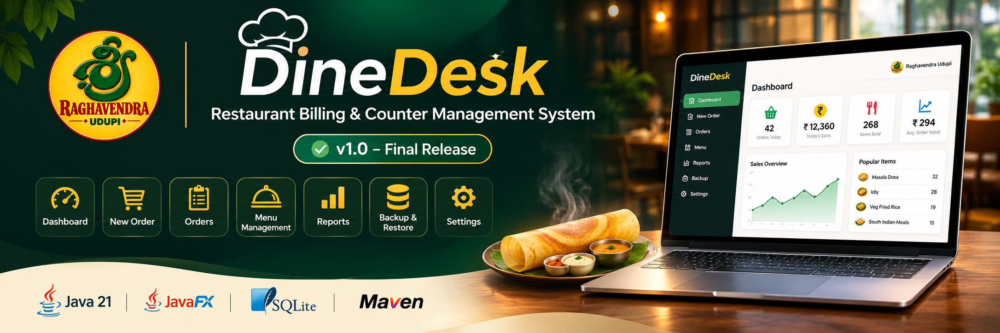
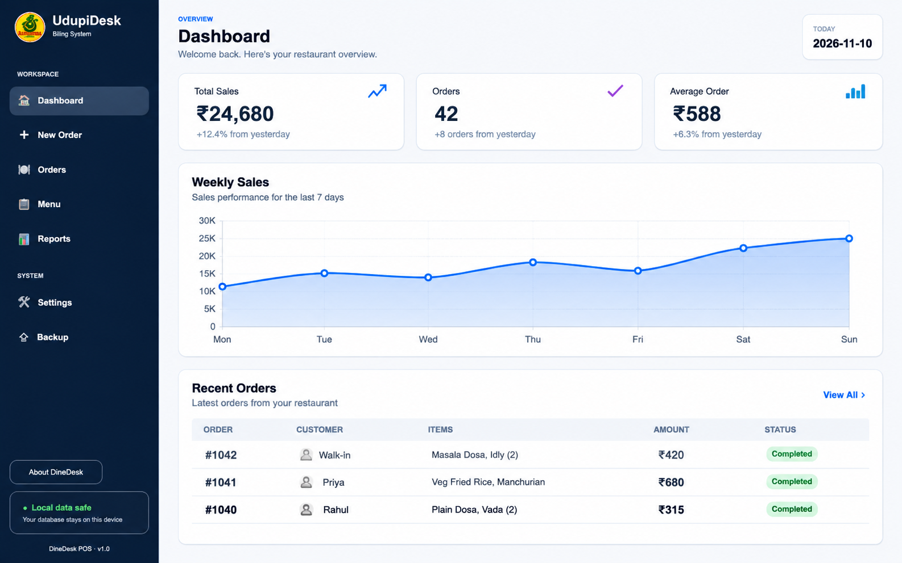
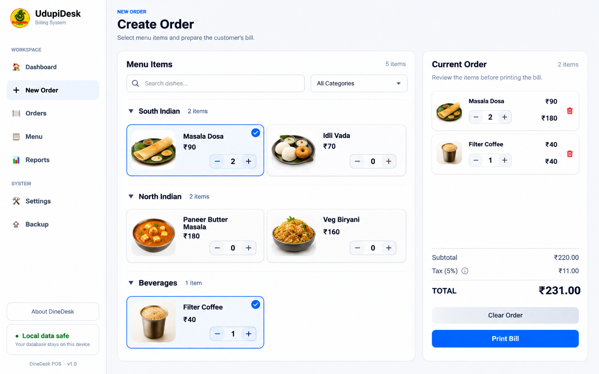
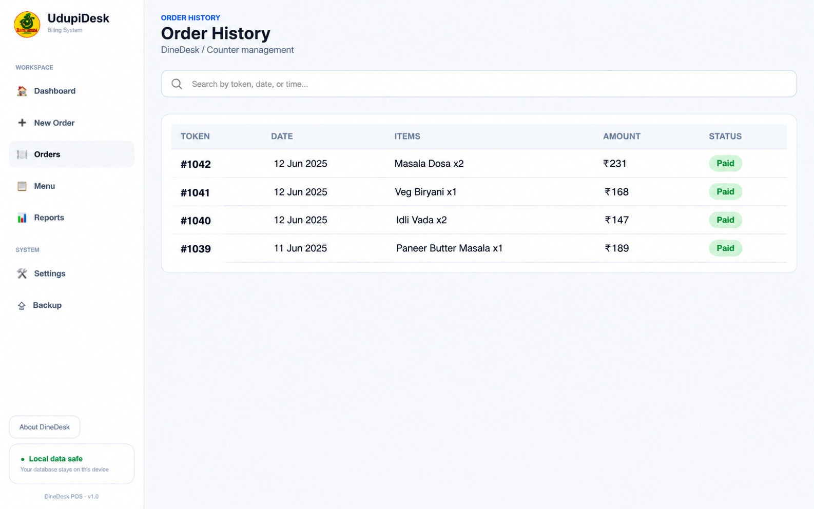
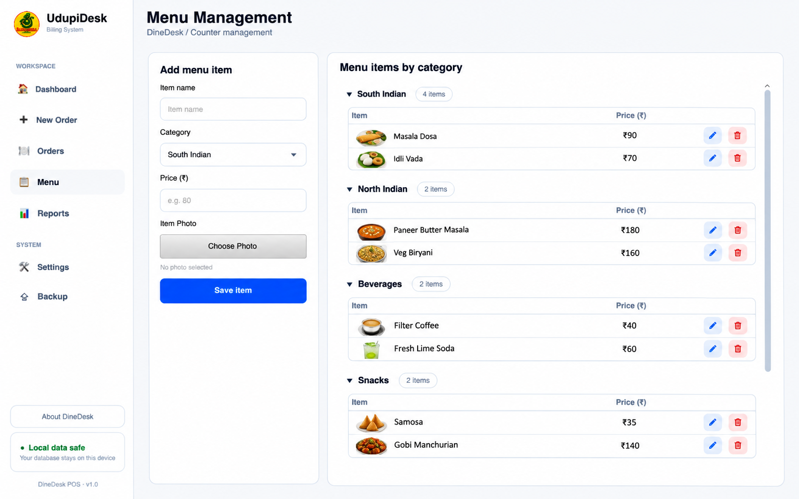
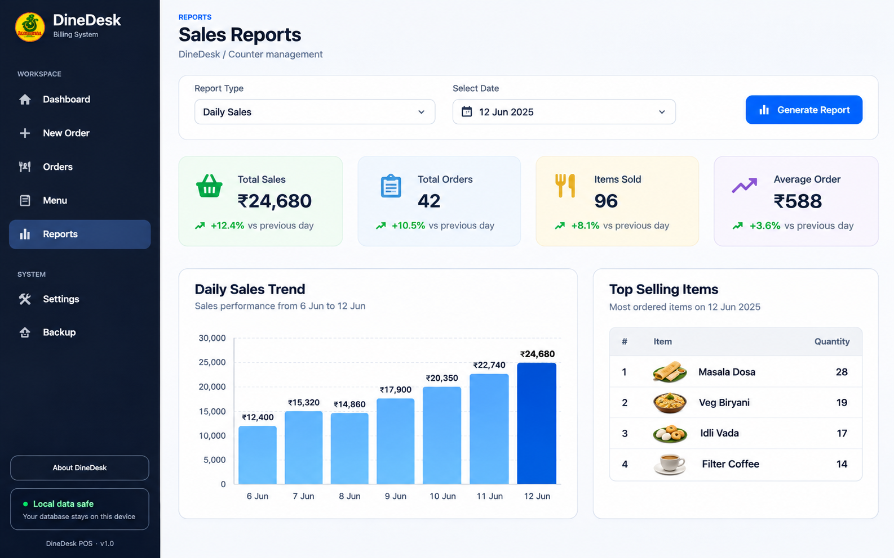
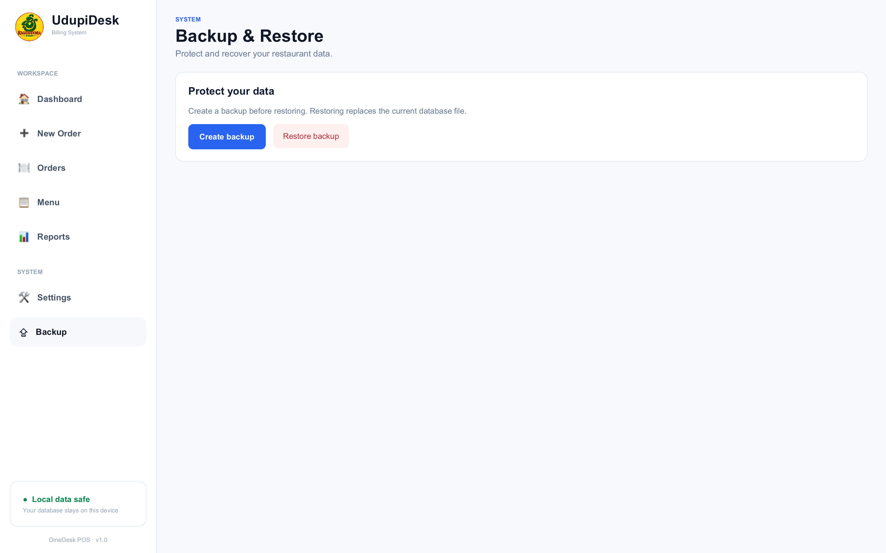
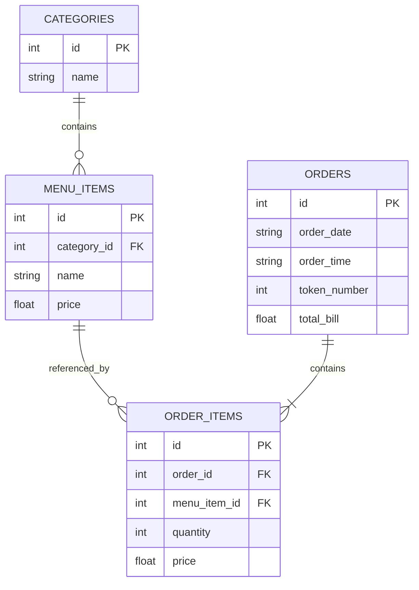
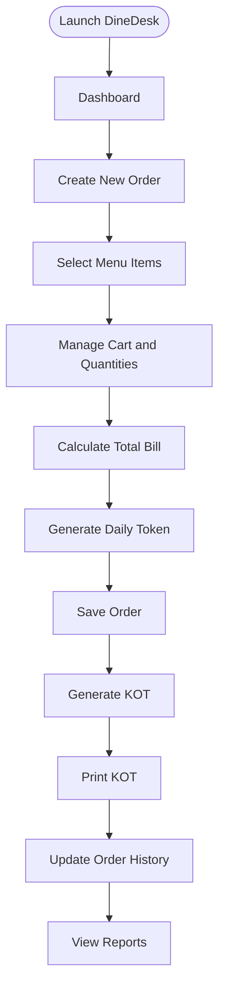

# 🍽️ DineDesk – Restaurant Billing & Counter Management System

<p align="center">
  <strong>A Modern Desktop Application for Smarter Restaurant Operations</strong>
</p>

<p align="center">
  
</p>

<p align="center">
  
  
  
  
  
  
</p>

---

## 📌 Overview

**DineDesk** is a desktop-based Restaurant Billing and Counter Management System developed to simplify everyday restaurant operations through an intuitive, organized, and efficient interface.

Designed primarily for single-counter restaurant environments, DineDesk streamlines order management, billing, token generation, Kitchen Order Ticket (KOT) management, menu administration, and sales reporting.

Built using **Java, JavaFX, and SQLite**, the application provides a structured approach to restaurant counter operations with local database storage.

DineDesk aims to reduce manual billing effort, improve order accuracy, and make restaurant operations easier to manage.

## ✨ Key Features

| Module | Features |
|---|---|
| 📊 Dashboard | Sales overview, order statistics and operational summary |
| 🛒 New Order | Menu browsing, cart management, quantity updates and automatic billing |
| 🧾 Orders | Order history, order details, searching and filtering |
| 🍽️ Menu Management | Category management, menu items and price editing |
| 🔢 Token Management | Automatic daily token generation |
| 👨‍🍳 KOT Management | Kitchen Order Ticket generation and printing |
| 📈 Reports | Daily sales, monthly sales and payment reports |
| 💾 Backup & Restore | Database backup and recovery |
| ⚙️ Settings | Application configuration and preferences |

## 🖥️ Application Interfaces

DineDesk provides a desktop interface designed around the primary activities of restaurant counter management.

### 1. Dashboard

The central overview of restaurant operations, providing quick access to application modules and business information.



### 2. New Order

A streamlined billing interface for selecting menu items, managing quantities, reviewing orders and calculating the total bill.



### 3. Orders Management

View and manage previously generated orders, retrieve order details and access historical transactions.



### 4. Menu Management

Manage restaurant menu categories, items and prices through an organized interface.



### 5. Reports

Access restaurant sales information and review daily and monthly business performance.



### 6. Backup & Restore

Manage database backups and restore application data when required.



> **Screenshot setup:** Replace these image paths with actual screenshots from your application. Keep the screenshots inside `docs/screenshots/` in your repository.

## 🛠️ Technology Stack

| Technology | Purpose |
|---|---|
| Java 21 | Core application development |
| JavaFX 21.0.6 | Desktop user interface |
| FXML | UI structure and layout |
| CSS | Interface styling |
| SQLite | Local database management |
| SQLite JDBC 3.50.3.0 | Database connectivity |
| Maven | Dependency management and build automation |
| IntelliJ IDEA | Development environment |
| Git & GitHub | Version control and source-code management |
| jpackage | Windows application packaging |
| WiX Toolset | Windows installer generation |

## 🏗️ Application Architecture

DineDesk follows a modular Java application structure that separates the user interface, controllers, database connectivity and application resources.

```text
DineDesk/
│
├── src/
│   └── main/
│       ├── java/
│       │   ├── module-info.java
│       │   └── com/dinedesk/
│       │       ├── Main.java
│       │       ├── controller/
│       │       ├── database/
│       │       ├── model/
│       │       ├── service/
│       │       └── util/
│       │
│       └── resources/
│           └── com/dinedesk/
│               ├── fxml/
│               ├── css/
│               └── images/
│
├── pom.xml
└── README.md
```

*Note: The structure above illustrates the main architectural organization. Refer to the actual repository for the complete implementation.*

## 🗄️ Database Design

DineDesk V1.0 uses **SQLite** for local data storage.

The primary database entities are:

| Table | Description |
|---|---|
| `categories` | Stores restaurant menu categories |
| `menu_items` | Stores menu items, category references and prices |
| `orders` | Stores order dates, times, tokens and total bills |
| `order_items` | Stores individual items and quantities associated with orders |

### Database Relationship



## ⚙️ Installation & Setup

### Prerequisites

For development, install:

- JDK 21
- IntelliJ IDEA
- Maven
- Git

The distributed Windows installer includes a Java runtime, so a separate Java installation is not required for end users.

### 1. Clone the Repository

```bash
git clone https://github.com/Koushik-Yelka-11/DineDesk.git
```

### 2. Navigate to the Project

```bash
cd DineDesk
```

### 3. Build the Application

```bash
mvn clean package
```

### 4. Run the Application

Open the project in IntelliJ IDEA and run the main application class:

```text
com.dinedesk.Main
```

### Windows Installation

DineDesk V1.0 was packaged as a Windows desktop installer using `jpackage` and WiX.

The installer bundles the application runtime and required JavaFX components.

For the final Windows installer, refer to the repository's Releases section.

## 🔄 Application Workflow



## 🎯 Project Objectives

- Digitize restaurant counter billing operations.
- Simplify menu and category management.
- Reduce manual billing calculations.
- Improve order tracking through daily token numbers.
- Streamline kitchen communication using KOT.
- Maintain organized order history.
- Provide useful sales and payment reports.
- Support local database backup and recovery.

## 🔐 Data Management

DineDesk V1.0 uses local SQLite database storage.

The application stores restaurant information on the local machine. Application source-code synchronization through GitHub does not synchronize local database records.

Database files and backups should be managed separately from the source-code repository.

## 🚀 Release Information

### DineDesk V1.0 – Final Release

Version 1.0 represents the first completed development release of DineDesk.

The release establishes the application's core functionality, desktop interface, database foundation and restaurant counter workflow.

**Development status:** Final release. No further V1.0 feature development is planned.

Future improvements and architectural enhancements will be developed independently under **DineDesk V2.0**.

## 🔮 Future Development

DineDesk V2.0 is planned as the next development phase, with potential improvements including:

- Enhanced UI/UX
- Improved application architecture
- Centralized data management
- Multi-computer support
- Shared order visibility
- Improved reporting
- Automated application updates
- Enhanced security and reliability

These are future development objectives and are not claims about the capabilities of V1.0.

## 👨‍💻 Developer

**Developed by Koushik Yelka**

Computer Science and Engineering | Java Developer

<p>
  <a href="https://github.com/Koushik-Yelka-11">
    
  </a>
</p>

**Project Repository:**  
https://github.com/Koushik-Yelka-11/DineDesk

---

<p align="center">
  <strong>DineDesk V1.0</strong>
  <br>
  Built to simplify restaurant operations.
  <br><br>
  ⭐ If you find this project interesting, consider giving it a star!
</p>
